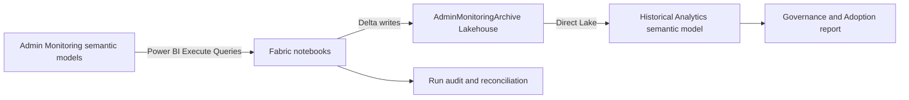

# Fabric Admin Monitoring Archive

[](https://github.com/kenichi-segawa/fabric-admin-monitoring-archive/actions/workflows/validate.yml)

A reference implementation for retaining Microsoft Fabric and Power BI **Admin Monitoring** data beyond the managed rolling window.

The project extracts Microsoft-managed gold-layer semantic models into a Fabric Lakehouse, preserves durable Delta history, validates every run, and exposes the archive through a Direct Lake semantic model and a six-page Power BI report.

> This repository contains templates only. It does not contain tenant data, credentials, tokens, workspace IDs, user identities, execution outputs, or customer screenshots.

## What this project solves

- Centralized visibility across Power BI and Fabric workspaces
- Report and item usage analytics
- Historical retention beyond the managed Admin Monitoring window
- Inactive and never-viewed report identification
- Workspace and capacity comparison
- Sharing, DLP, sensitivity-label, endorsement, and domain governance
- Restricted user-level drillthrough
- Audited and reconciled daily incremental processing

## Prerequisites

- A directly assigned Fabric Administrator who can access Admin Monitoring
- Build/query access to all four managed Admin Monitoring semantic models
- Dataset Execute Queries REST API enabled in tenant settings
- Contributor or Admin access to the target Fabric workspace
- An active Fabric capacity supporting Spark, Lakehouse, Direct Lake, and Power BI
- Lakehouse write access and permission to run child notebooks
- Power BI Pro/PPU for authors and consumers when using capacity below F64
- Fabric Spark 3.4+ with built-in Semantic Link and NotebookUtils

See [docs/PREREQUISITES.md](docs/PREREQUISITES.md) for the complete checklist.

## Architecture



## Solution components

| Component | Purpose |
|---|---|
| `00_Validate_Admin_Monitoring_Access` | Confirms access to all managed models, metadata, and sample data |
| `01_Provision_Admin_Monitoring_Lakehouse` | Creates/reuses the Lakehouse and initializes control tables |
| `02_Extract_Admin_Monitoring_Models` | Runs baseline or daily extraction with count and schema validation |
| `03_Daily_Admin_Monitoring_Archive` | Scheduled orchestrator; runs extraction and reconciliation |
| `04_Reconcile_Admin_Monitoring_Archive` | Verifies completeness, counts, schemas, and Delta targets |
| `Admin Monitoring Historical Analytics.SemanticModel` | Direct Lake TMDL model |
| `Admin Monitoring Governance & Adoption.Report` | Six-page PBIR report |

## Quick start

### Prerequisites

- Fabric administrator access
- Access to the Admin monitoring workspace
- Contributor access to a Fabric-capacity target workspace
- Fabric Spark runtime with built-in Semantic Link and NotebookUtils
- XMLA connectivity enabled as required by the managed models
- Power BI Build/query access to the managed semantic models
- Node.js 20+ for PBIR generation and validation

### Configure

Replace these placeholders in your deployment copy:

| Placeholder | Meaning |
|---|---|
| `YOUR_TARGET_WORKSPACE` | Target Fabric workspace name |
| `YOUR_WORKSPACE_ID` | Target workspace GUID |
| `YOUR_LAKEHOUSE_ID` | `AdminMonitoringArchive` Lakehouse GUID |
| `YOUR_SEMANTIC_MODEL_ID` | Deployed historical semantic model GUID |

The notebooks dynamically resolve most IDs. The Direct Lake named expression in `solution/...SemanticModel/definition/expressions.tmdl` requires the workspace and Lakehouse IDs.

### Run in order

1. Import and run notebook 00.
2. Import and run notebook 01.
3. Import and run notebook 02 in its default `baseline` mode.
4. Run notebook 04 to reconcile the baseline.
5. Import notebook 03 and schedule it daily.
6. Deploy the semantic model TMDL.
7. Frame the Direct Lake model with an `Automatic` refresh.
8. Generate, validate, and publish the PBIR report.

## Daily operation

Schedule **notebook 03 only**:

```text
03 Daily Orchestrator
  ├─ 02 Extract Models (run_mode=daily)
  └─ 04 Reconcile (exact run_id from extraction)
```

Do not schedule notebooks 02 and 04 separately. Doing so can create duplicate loads or reconcile the wrong run.

See [docs/OPERATIONS.md](docs/OPERATIONS.md) for scheduling and recovery procedures.

## Lakehouse organization

```text
AdminMonitoringArchive
├── admin_monitoring
│   ├── content_sharing__*
│   ├── feature_usage_and_adoption__*
│   ├── onelake_catalog_governance_for_admins__*
│   ├── purview_hub__*
│   └── dormancy_window
└── admin_monitoring_control
    ├── table_manifest
    ├── run_audit
    ├── schema_history
    └── reconciliation
```

See [docs/SCHEMA.md](docs/SCHEMA.md) for the extraction manifest and stored history columns.

## Important implementation choices

- Uses Power BI REST discovery because the protected Admin Monitoring workspace does not behave like a normal Fabric workspace through every SemPy/Fabric Core API.
- Uses row hashes because the managed Audit table does not expose the native Activity Events event ID.
- Preserves exact duplicate multiplicity in `_duplicate_count`.
- Fails explicitly if source and extracted counts differ.
- Records source schema hashes on every run.
- Uses a single daily orchestrator to preserve operational lineage.
- Keeps the Power BI Admin Activity Events and Scanner APIs as the recommended production-hardening path.

## Documentation

- [Architecture](docs/ARCHITECTURE.md)
- [Prerequisites](docs/PREREQUISITES.md)
- [Notebook walkthrough](docs/NOTEBOOKS.md)
- [Lakehouse schema](docs/SCHEMA.md)
- [Operations runbook](docs/OPERATIONS.md)
- [Fabric validation evidence](docs/VALIDATION.md)
- [Security and privacy](docs/SECURITY.md)
- [Admin REST API alternative](docs/ADMIN-REST-API-ALTERNATIVE.md)

## Validate locally

```powershell
python scripts/validate_solution.py
npm install -g @microsoft/powerbi-report-authoring-cli@latest
powerbi-report-author validate "solution/Admin Monitoring Governance & Adoption.Report"
```

The report uses a local `byPath` semantic-model reference in this public template. Change it to the Fabric API `byConnection` form only during publishing.

## License

MIT. See [LICENSE](LICENSE).
